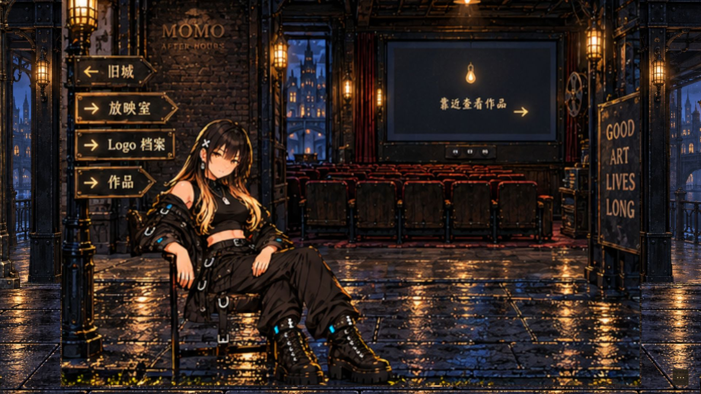

# 魔魔王 · 午夜街区

## [↗ 进入魔魔王网站](https://momowangouo.github.io/momowang-city/)

**连续插画城市 · 分层视差 · Logo 档案**

[沿街探索](https://momowangouo.github.io/momowang-city/#street) · [玻璃廊](https://momowangouo.github.io/momowang-city/#glass) · [放映区](https://momowangouo.github.io/momowang-city/#cinema)

这是魔魔王的个人作品站。六个站点与五段连接街道连成一幅城市全景大图，镜头沿街移动，在预设观赏位置停靠；前景、人物与建筑通过分层视差展开距离。

各站角色保留独立姿势与固定眼神，通过眨眼、衣料和发片表现呼吸，高架列车循环穿过街区。Logo 终端提供列表、筛选、版本与下载；放映区预留三个作品位置。载入时，魔魔王 Logo 循环写出、停留、擦除，再重新写出。

[阅读图文设计报告（PDF）](https://momowangouo.github.io/momowang-city/design-report.pdf) · [本次交付记录](delivery-record.json)

本次采用稳定分层：室内完整组件保持刚性，窗外城市、天空、人物与前景分别移动。859 项检查与两类构建通过；浏览器桌面及竖屏路线已复核，补充检查了超宽阅读、短横屏与旋转恢复。回退版本保留在 `rollback-before-stable-20261012` 标签。

本仓库保存公开静态网站及已获授权的素材，由 GitHub Pages 发布。开发源码和制作源图保存在私人仓库，签名母版审批状态独立于网站展示。

真实移动设备验收仍待完成。
